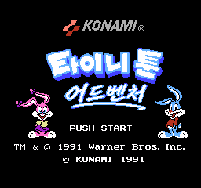

# 타이니 툰 어드벤처스 — 패미컴 / NES

패미컴 / NES **타이니 툰 어드벤처스** 한글 번역 패치 프로젝트입니다. 타이니 툰 캐릭터들이 등장하는 횡스크롤 액션 게임입니다.

> **정식 배포 v1.0.1**

<!-- game-preview:start -->

  

**한글 타이틀** — kr_smoke_001 Mesen 캡처
<!-- game-preview:end -->

## 다운로드 및 적용 방법

1. 아래 체크섬 또는 상세 안내와 일치하는 원본을 준비합니다.
2. [최종 배포 패치 다운로드](https://github.com/akuma815/nes-tiny-toon-adventures-kr-patch/releases/tag/v1.0.1)에서 ZIP을 받아 모두 압축 해제합니다.
3. 원본 ROM 또는 ISO를 동봉 `apply.cmd`에 끌어다 놓습니다.
4. 생성된 한글판 파일의 SHA-256을 확인하고 실행합니다.

## 주의사항

- 일본판 원본 전용입니다.
- 당근 교환 후 대기 중 글꼴이 바뀌는 문제를 수정한 버전입니다.
- 등록 장면의 검증과 전체 완주 검수는 구분하며, 최종 문구 검토·실기 검증은 미완료입니다.
- 원본 게임·BIOS 및 패치가 적용된 게임 이미지는 포함하지 않습니다.

## 체크섬

| 구분 | SHA-256 |
| --- | --- |
| 원본 | `73300dc1505564827ef95ba3e2a06c26aa48920e4981195f32b2101c185ef3dd` |
| 패치 파일 `TinyToonAdventures_KR_v1.0.1_20261004.xdelta` | `03d916e0440fdd52fe97c0223dfbac6931ea15a0dd7c36acdd4a10ae00620878` |
| 패치 후 이미지 | `d57b816fce99d99eb700ebecc3d2397a1d039418ead3b1233d720c712fb2df3d` |
| 배포 압축 파일 | `d3bf3ae72fe6567fd5386aa7db2be07d94da1c1092d4ac1c3866cc31f2b4baa7` |

## 소스 및 작업 기록

[공개 소스 구성과 빌드 전제](docs/SOURCE_GUIDE.md) · [상세 패치 안내](docs/PATCH_GUIDE.txt)

## 최종 빌드 재현

[원본에서 재현하는 명령과 필수 입력](docs/REBUILD_RELEASE.md)을 확인하세요. 기존 패치의 결과와 같은 SHA를 생성하며, 새 플레이 검수 결과를 뜻하지 않습니다.
